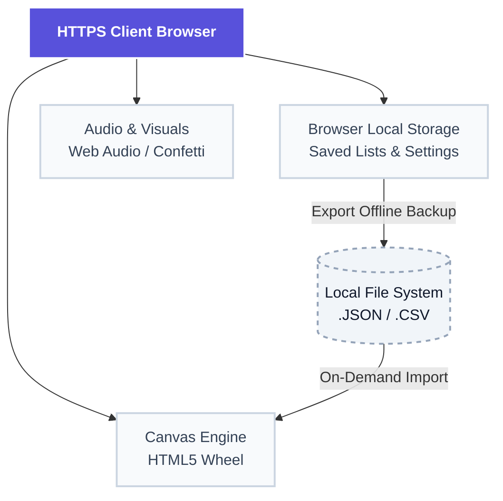

# Netwrix-Branded Interactive Picker Wheel & Scoreboard

### TL;DR Summary

* **Zero Trust Architecture:** Fully decentralized, client-side execution ensures zero server-side telemetry, no identity data transit, and total local state isolation within the browser's sandbox.
* **Value Realization Event (VRE) Ready:** Specially designed to drive stakeholder engagement during VREs, executive workshops, and alignment sessions using strategic "Spins to Win" consensus rules.
* **Turnkey Deployment:** Optimized for multi-tenant server infrastructure with seamless compatibility for Dokploy, standalone Docker containers, Nginx, or GitHub Pages.

---

## 🏗️ System & Security Architecture

The application operates entirely within the user's User-Agent (browser). There is no back-end application server processing your team names, organizational directories, or assessment data.



### Security Posture & Compliance Safeguards

* **No Active Identity Probing:** The application does not integrate with Active Directory, LDAP, or SaaS Identity Providers directly. All list configurations are manual or bulk CSV-loaded to keep operational roster assets completely off-network.
* **Data Sovereignty:** All configuration states and spin outcomes exist in ephemeral memory or browser storage. No data is shared with Netwrix or third-party servers.

---

## 🐳 Deployment Protocols

This is a static web application contained entirely in a single file (`index.html`). Below are the deployment playbooks to clear your infrastructure team for production deployment.

### 1. Dokploy Deployment (Enterprise PaaS)

Using **Dokploy**'s Traefik reverse proxy allows you to serve this application securely alongside other sites on your Ubuntu server.

#### A. Repository Setup

Your GitHub repository must contain:

1. `index.html` (The application source)
2. `Dockerfile` (Constructed below)

#### B. The `Dockerfile`

Create a `Dockerfile` in the root of your repository to containerize the app with a highly optimized, lightweight Alpine Nginx server:

```dockerfile
FROM nginx:alpine
# Copy our static build to the server's public directory
COPY index.html /usr/share/nginx/html/index.html
EXPOSE 80
CMD ["nginx", "-g", "daemon off;"]
```

#### C. Dokploy Dashboard Operations

1. Go to your **Dokploy Panel** -> Select your **Project** -> Add a **Service** -> Select **Application**.
2. Connect your Git provider and select the corresponding repository.
3. In **Build Settings**, set **Build Type** to **Dockerfile**.
4. In **Ports**:
   * **Host Port:** Choose your desired open port (e.g., `8080`).
   * **Container Port:** Set to `80`.
5. In **Domains** (Optional but Recommended for Let's Encrypt TLS):
   * Add your domain mapping (e.g., `wheel.yourcompany.com`).
6. Click **Deploy**.

---

### 2. Standalone Docker Run

If deploying via command line directly to a Docker engine:

```bash
# Build the image from your local directory
docker build -t netwrix-picker-wheel .

# Run the container mapping host port 8080 to container port 80
docker run -d --name interactive-wheel -p 8080:80 netwrix-picker-wheel
```

---

### 3. GitHub Pages Deployment (Zero-Infrastructure Option)

1. Commit `index.html` to a public or enterprise-managed GitHub repository.
2. Go to **Settings** -> **Pages** (on the left sidebar).
3. Under **Build and deployment**, select **Deploy from a branch**.
4. Set branch to `main` (or `master`) and directory to `/ (root)`.
5. Click **Save** to generate your secure live link.

---

## 📊 File Import Schemas

To quickly load customer assessment scopes, system endpoints, or session participants, utilize the built-in bulk-loading features via the **File** menu.

### 1. CSV Import Specifications

The CSV parser reads up to **three column variables** sequentially. Commas must be used as separators.

| Column | Name | Required | Description | Example | 
| :--- | :--- | :--- | :--- | :--- | 
| **Col 1** | Text | **Yes** | The default display string of the choice. | `Active Directory` | 
| **Col 2** | Label | No | Alternate alias to show on the wheel/scoreboard. | `AD Security` | 
| **Col 3** | Weight | No | Relative sizing probability on the wheel. | `1.5` | 

#### `sample_roster.csv`

```csv
Active Directory, AD Security, 1.5
Entra ID, Cloud Identity, 1.0
Access Management, Privileged Access (PAM), 1.0
Data Security,, 2.0
```

*Note: Row 4 illustrates how to omit the optional Label column while still passing a custom slice Weight of 2.0.*

---

## ⚔️ Tactical Operational Evaluation (51/49 Rule)

This matrix outlines the operational advantages vs. system limitations to ensure your presentation teams are Technically Cleared to Close (TCC) when relying on this system:

| Strategic Advantages (51%) | Key System Trade-offs (49%) | Mitigation Strategy | 
| :--- | :--- | :--- | 
| **No Database Overhead:** Instant spin-up on any container platform with zero database provisioning. | **LocalStorage Vulnerability:** Clearing browser cache or switching devices wipes saved lists. | **Policy Directive:** Require SE teams to export critical configurations to `.json` or `.csv` using the built-in backup tools before sessions. | 
| **VRE Value-Consensus Model:** "Spins to Win" ensures scoring consensus rather than premature exits. | **Client-Side Processing:** Scale is limited to what the local CPU/Canvas Engine can render fluidly (approx. 500 choices). | **Best Practice:** Keep customer rosters or priority lists to under 100 choices for maximum visual clarity. | 
| **Identity Privacy Compliant:** Absolute adherence to enterprise organizational data protocols. | **No Live Multi-user Sync:** Sessions cannot be shared in real-time across multiple client browser engines. | **Best Practice:** The presenter screenshares the master interface over Zoom/Teams during VRE alignment. | 

---

## 🛠️ Next Steps & Best Practices

1. **Brand Alignment:** Go to **Settings -> Banner & Logo** to update your banner URL or select custom text to reflect your strategic customer's logo.
2. **Setup Consensual Playbook:** For team VRE alignments, set the **Spins to Win** criteria to `3` in Settings. This prevents early anomalies from dictating final outcomes and simulates a natural process.
3. **Save Backup Templates:** Keep a local directory of standard strategic lists (e.g., AD Security Frameworks, DSPM Discovery Targets, PAM Priority Items) as JSON templates ready to import instantly when you kickoff a customer meeting.
